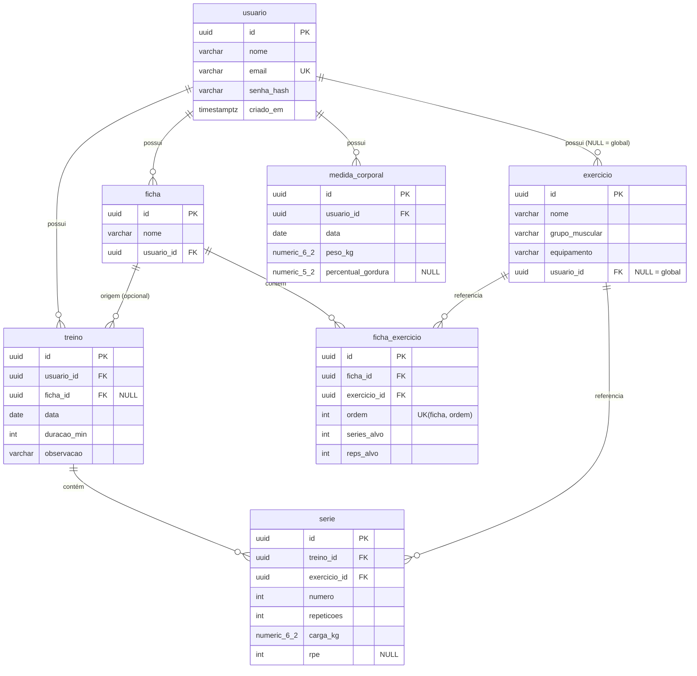

# Acompanhamento de Treino

App full stack para registrar treinos de musculação, acompanhar progressão de carga (1RM estimado por Epley) e gerenciar exercícios e fichas. Projeto de referência para estudo: código limpo, em camadas, comentado nos pontos conceituais.

## Stack

- Backend: Java 21, Spring Boot 3.3.5, Maven (wrapper), Web, Data JPA, Validation, Security + JWT (jjwt), PostgreSQL 16, Flyway, Springdoc OpenAPI, Actuator. **Sem Lombok** (DTOs como `records`, entidades explícitas).
- Frontend: React 18 + Vite 5 + TypeScript 5, React Router 6, TanStack Query 5, React Hook Form + Zod, Recharts 2, CSS puro mobile-first (sem Tailwind — decisão abaixo).
- Testes: JUnit 5, Mockito, Testcontainers (Postgres), MockMvc.
- Infra: Docker multi-stage, docker-compose (`db` + `api` + `web`), GitHub Actions.

## Como rodar (1 comando)

Pré-requisitos: Docker com plugin Compose, Java 21 e Node 20 (só para rodar fora do Docker).

```bash
cp .env.example .env   # gere um JWT_SECRET real: openssl rand -base64 48
docker compose up --build
```

- Web: http://localhost (Nginx) · API: http://localhost:8080/health · Swagger: http://localhost:8080/swagger-ui.html

Desenvolvimento local:

```bash
docker compose up -d db          # só o Postgres
cd backend; ./mvnw spring-boot:run
cd frontend; npm install; npm run dev   # http://localhost:5173
```

Testes: `cd backend; ./mvnw verify` (exige Docker p/ Testcontainers) · `cd frontend; npm run build`.

## Decisões de arquitetura

- **Camadas finas**: `controller → service → repository → domain`; controller nunca vê entidade (só `records` com mapeamento manual — explícito > magia).
- **Schema só por Flyway** (`V1__create_schema.sql`, `V2__seed_exercicios.sql` com 30 globais); `ddl-auto=validate` — o Hibernate confere, nunca altera.
- **Transacional**: `POST /treinos` é `@Transactional`; qualquer série inválida dá rollback total.
- **Isolamento por usuário**: tudo filtra pelo `usuarioId` do JWT; recurso alheio retorna **404** (não 403, para não vazar existência). Recorde/histórico usam `LEFT JOIN` explícito para não excluir exercícios globais (path navigation geraria inner join).
- **1RM por Epley** (`carga × (1 + reps/30)`); PR = `carga > max OU epley > maxEpley` (primeira série com carga conta AMBOS; peso-corporal nunca gera PR).
- **Volume = Σ reps × carga**, agregado por semana ISO (segunda-feira) no Java.
- **Erros padronizados** `{timestamp, status, mensagem, caminho, errosCampos[]}` via `@RestControllerAdvice` (inclusive o 401 do Security, escrito à mão no entry point).
- **CSS puro em vez de Tailwind**: 1 dependência a menos, mais didático, suficiente para inputs de 56px e tabbar — velocidade na academia > efeitos.
- **Tipos TS manuais** espelhando os DTOs (fallback documentado: `npx openapi-typescript http://localhost:8080/v3/api-docs -o src/api/types.ts`).
- **Segurança**: BCrypt, JWT 1h via `JWT_SECRET` (fail-fast sem default), CORS restrito por env.
- Ordem de construção: segurança (F6) antes dos CRUDs para o isolamento nascer junto, sem relink.

## Diagrama ER (Mermaid)



## Estrutura

`backend/` (Spring Boot) · `frontend/` (Vite React) · `docs/` (BACKLOG + `fase-N-explicacao.md`) · `.opencode/agent/` (8 subagentes) · `docker-compose.yml` · `AGENTS.md` (convenções) · `APRENDIZADOS.md` (seu caderno).
